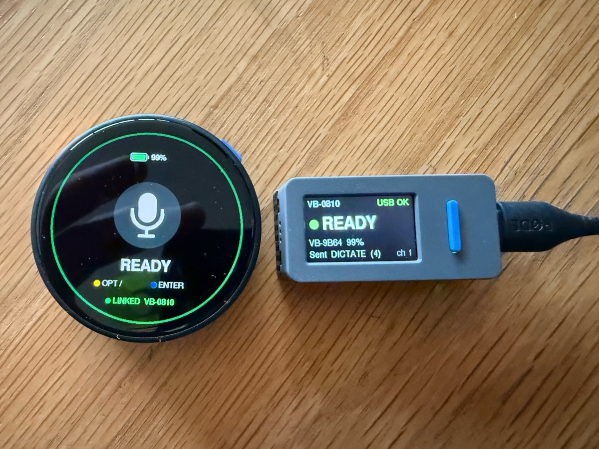
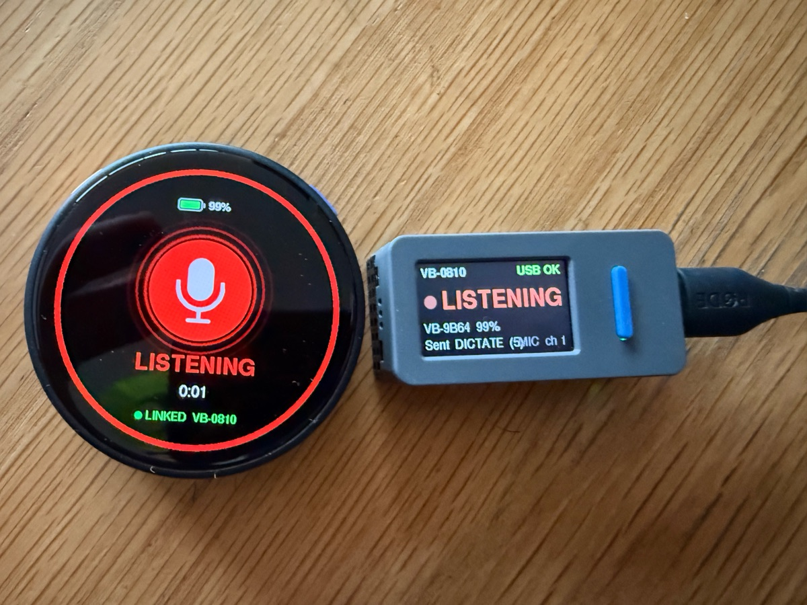

# VoiceInk Button

A wireless push-to-talk remote for [VoiceInk](https://github.com/Beingpax/VoiceInk), the macOS
dictation app. Press a button, speak, press again: VoiceInk transcribes and pastes the text. The
remote's mic travels with you, so you can dictate from the sofa, standing at a whiteboard, or pacing
the room.

<p>
  
  
</p>

*The remote (left) and the dongle (right): ready, then listening.*

It is two M5Stack devices running this firmware:

- **Remote:** an M5Stack **StopWatch** (ESP32-S3, round touch screen, two buttons, mic, battery).
- **Dongle:** an M5Stack **StickS3**, plugged into the Mac. It shows up as a USB keyboard, which
  presses VoiceInk's shortcut, and a USB microphone, **VoiceInk Button Mic**, which carries the
  remote's audio.

The two talk over ESP-NOW, encrypted, after a one-time pairing with a 6-digit code. No Mac app or
driver is needed.

> Unofficial. VoiceInk Button is a community project and is not affiliated with or endorsed by
> VoiceInk.

## Using it

**Buttons**

| | Press | Hold |
|---|---|---|
| **Yellow** | Start / stop dictation | Reset the remote to idle without sending anything, if it ever gets out of step with VoiceInk |
| **Blue** | Enter. While dictating: stop, wait for VoiceInk to paste, then Enter. Press blue again to send at once, or yellow to cancel. | Back, in menus |

- **Wake:** a button, a touch or picking it up. A press on a dark screen only wakes it. Touch and
  pickup can be turned off under Settings; with both off, only the buttons wake it.
- **Menu:** swipe down from the top. It has **Add dongle**, **Dongles**, **Settings** (wake on
  pickup, wake on touch, brightness), **Reboot** and **Power off**.
- **In lists:** tap a row, or move with yellow and blue and hold yellow to choose. To forget a
  dongle, open **Dongles**, hold the row until it buzzes, then tap it.

**What the screens say**

| Word | Meaning |
|---|---|
| **READY** | Linked, idle |
| **LISTENING** | Dictating: the remote's mic is streaming to the Mac |
| **DIMMED** | Idle for 10 s; any touch brings it back |
| **ASLEEP** | Remote asleep (dongle screen); radio off to save battery |
| **SEARCH…** | The dongle can't hear the remote |
| **NO USB** | The dongle lost the Mac. Press A on the dongle, or blue on the remote, to restart it |

The remote follows VoiceInk. If you stop or cancel a recording on the Mac, the remote notices,
because the dongle sees VoiceInk close the mic.

**Power.** On battery, the remote dims after 10 s, then turns off its screen and radio after 20 s.
The green LED blinks every 2 s while awake and every 5 s while asleep. Waking and relinking takes
about half a second. On USB the remote never sleeps; only its screen turns off. The dongle turns on when plugged in and off when
unplugged.

**When the remote is asleep,** the dongle removes VoiceInk Button Mic from the Mac. Recordings you
start on the Mac then use the Mac's own mic instead of recording silence. The mic comes back as soon
as the remote wakes.

## Set up VoiceInk

1. **Shortcut.** In VoiceInk's settings, set the **Primary Shortcut** to **⌥ /** (Option + slash)
   and its mode to **Toggle**. That is the key the dongle presses. To use another one, change
   `DICTATE_MODIFIERS` and `DICTATE_KEY` in
   [firmware/common/vb_keys.h](firmware/common/vb_keys.h) and reflash both devices. VoiceInk must
   use toggle mode, because the dongle taps the shortcut; it doesn't hold it down.
2. **Microphone.** In VoiceInk's audio input settings, choose **Custom Device** → **VoiceInk Button
   Mic**. Or choose **Prioritized** with VoiceInk Button Mic first and your Mac's mic second. Either
   way, VoiceInk falls back to another mic while the remote is asleep. The remote has to be awake
   for VoiceInk Button Mic to appear in the list.
3. **Keyboard Setup Assistant.** The first time the dongle is plugged in, macOS may ask you to
   identify the keyboard. Close the window; nothing needs to be set up.

### If a press types ÷ instead of starting VoiceInk

⌥/ types ÷ when VoiceInk didn't catch the shortcut. Usually another app holds macOS *secure input*:
a focused password field in a browser, a password manager, or some terminals. While secure input is
on, no app can catch global shortcuts, and the same happens with your real keyboard. To find which
app holds it:

```sh
ioreg -l -w 0 | grep -o '"kCGSSessionSecureInputPID"=[0-9]*'   # then: ps -p <pid>
```

Click out of the password field, or quit the app, and the button works again.

[mac/make_toggle_shortcut.py](mac/make_toggle_shortcut.py) builds a macOS Shortcut that runs
VoiceInk's *Toggle VoiceInk Recorder* action without a keystroke. It is a starting point for a
trigger that secure input can't block; see
[docs/PRD-mic-presence.md](docs/PRD-mic-presence.md), section 9.

## Build and flash

You need macOS, Python 3, and these tools:

```sh
brew install arduino-cli esptool
arduino-cli config add board_manager.additional_urls https://static-cdn.m5stack.com/resource/arduino/package_m5stack_index.json
arduino-cli core update-index && arduino-cli core install m5stack:esp32
arduino-cli lib install M5Unified M5GFX
```

Built and tested with the m5stack:esp32 core 3.3.10.

**Name your boards.** Flashing only touches the two boards you list, so another ESP32 on your desk
can't be overwritten by accident. Plug both in, then:

```sh
make boards                  # lists connected ESP32-S3 boards: MAC, name, port
cp boards.example.mk boards.mk
# edit boards.mk: HANDHELD_MAC = the StopWatch, DONGLE_MAC = the StickS3
```

**Flash:**

```sh
make flash-handheld          # StopWatch
make flash-dongle            # StickS3 that already runs this firmware
make monitor-handheld        # serial log
make monitor-dongle
```

**First flash of a StickS3,** or after a crash: hold its side button for about 2 s until the green
LED blinks (download mode), then run `make first-flash-dongle`. A StopWatch goes into download mode
the same way, with its power button.

Flashing keeps pairing and settings.

## Pair

On the remote, swipe down → **Add dongle** and pick the dongle (`VB-xxxx`, from the last digits of
its MAC). Check that both screens show the same 6-digit code, then accept with yellow on the remote
and **A** on the dongle.

- The remote remembers up to 4 dongles; switch between them under **Dongles**.
- To pair a dongle that is already paired with another remote, hold **A** on it for 3 s to put it
  back into pairing mode. Holding **B** for 6 s makes it forget its remote.

## Tuning and diagnostics

Timings and the battery settings are in [firmware/handheld/config.h](firmware/handheld/config.h);
the shortcut and the send key are in [firmware/common/vb_keys.h](firmware/common/vb_keys.h).

The serial port takes single-letter commands:

| Key | Board | Prints |
|---|---|---|
| `d` | both | boot history |
| `p` | remote | pickup (wake) log |
| `a` | remote | ten raw accelerometer readings |
| `b` | remote | battery log, the last ~2 h |
| `v` | dongle | power source, mic and link state |

**Battery level.** The remote can only measure its battery's voltage, and charging pushes that up.
So on USB it pauses charging for 3 s once a minute to take its reading. The shown level only falls
on battery and only rises on USB, so plugging in or unplugging doesn't make it jump.

## Security

- Pairing uses X25519 with a commitment and a 6-digit code you compare on both screens. After that,
  every packet is encrypted by ESP-NOW and carries an HMAC tag with a per-session key. The fixed
  ESP-NOW primary key in the source only wraps the per-pair key on the chip; it isn't a secret.
- The dongle types only its own two keys, the dictation shortcut and Enter
  ([vb_keys.h](firmware/common/vb_keys.h)). The remote says which one to press, never what to
  type, so even a lost remote can't type anything else.
- A replayed link packet can't start or reset a session. The dongle switches to a new session only
  once the remote uses it.
- The pairing keys are stored on the remote without flash encryption. If you lose the remote, hold
  **B** on the dongle for 6 s to make it forget it.

## License

Copyright (C) 2026 Jan Rod. VoiceInk Button is free software under the
[GNU General Public License v3.0](LICENSE), the same license as VoiceInk.
